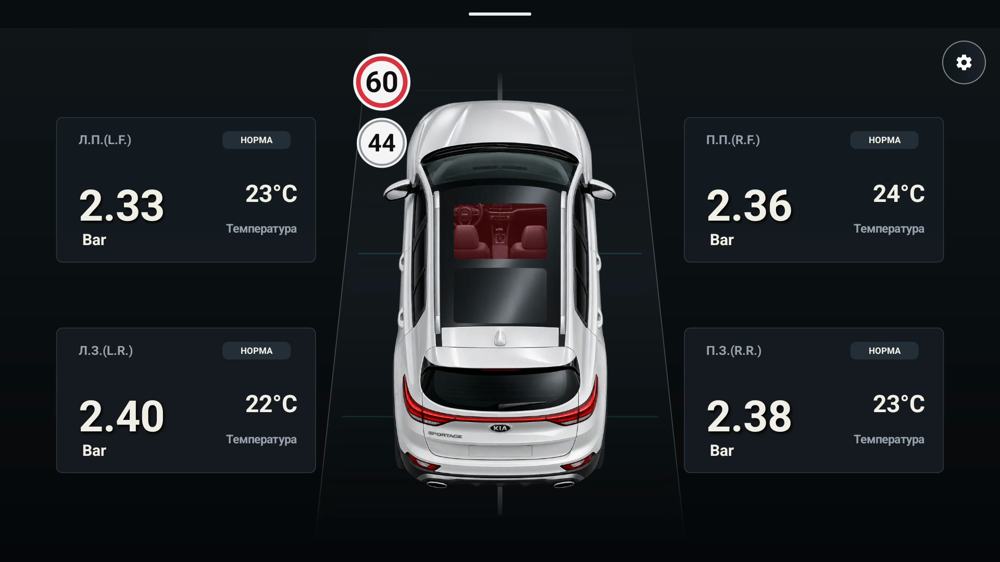

# KIA CANBUS

Android-приложение для магнитол TEYES CC4 и CC4 Pro в Kia. На главном экране видны давление и температура каждого колеса, состояние люка и дорожное ограничение скорости. Через совместимый USB CAN-адаптер приложение выводит навигацию, музыку и звонки на штатную приборную панель.

**[Скачать APK для магнитолы](https://github.com/mrglonin/kia/releases/latest)** · [Что изменилось](CHANGELOG.md) · [Проверки сборки](https://github.com/mrglonin/kia/actions/workflows/android.yml)



*Демонстрационные данные в Android-эмуляторе.* [Видео работы главного экрана, MP4](https://github.com/mrglonin/kia/releases/download/v23.31-385/dashboard-385.mp4)

## Установка и обновление

1. **Если KIA CANBUS уже установлен**, откройте **Настройки → Общее → Проверить APK**. Когда появится новая версия, нажмите **Обновить APK** и подтвердите установку в Android.
2. **Для первой установки** откройте страницу последнего релиза, скачайте файл `kia_…apk` из раздела **Assets** и откройте его на магнитоле. Минимальная версия системы — Android 10. [Последний релиз](https://github.com/mrglonin/kia/releases/latest)
3. Подключите совместимый переделанный и прошитый USB CAN-адаптер. При первом подключении разрешите приложению доступ к USB в системном диалоге. Совместимость зависит от модели автомобиля, приборной панели и прошивки адаптера. [Описание переделки от автора](https://www.drive2.ru/l/717368666034802531/)
4. Откройте нужную вкладку в настройках. Для работы оверлеев понадобится разрешение поверх других окон, для отдельных источников музыки — доступ к уведомлениям, для курса по GPS — геолокация.

## Что показывает приложение

| Раздел | Данные и управление |
| --- | --- |
| **TPMS и люк** | Давление и температура каждого колеса, предупреждения по порогам, состояние люка и звуковое напоминание. Для совместимого штатного виджета TEYES можно включить передачу давления. |
| **Навигация** | Маршрут, манёвры, расстояния и ограничения от выбранного источника. Поддерживаются Yandex Core Bridge, 2ГИС и MVite. В настройках можно выбрать режим приборки и формат компаса Kia Navi. |
| **Медиа и звонки** | Название трека, источник звука и информация о вызове на приборке. Источники включают проигрыватели Android, Bluetooth и радио TEYES. |
| **RCTA** | Предупреждения о поперечном движении при выезде задним ходом. Сторона события определяет сторону индикации на экране. Доступны сигнал и голосовые подсказки. |
| **ADAS** | Состояние подключения к штатному TEYES ADAS, приём данных о разметке и предупреждения о выезде из полосы. **Диагностика** наблюдает за сервисом 10 секунд, **Скопировать отчёт** сохраняет результат в буфер обмена. В этой версии вывод LDW от TEYES на приборку Sportage пока не реализован. |
| **CANBUS** | Состояние USB-соединения и адаптера. В общих настройках можно экспортировать диагностику и перенести настройки приложения. |

**Откуда берётся знак скорости.** На главном экране используется дорожный лимит от навигационного приложения. Знак меняется при получении нового значения и исчезает через 12 секунд без свежих данных или при явном сбросе лимита. Ограничение у камеры контроля скорости в этот знак не подставляется. Передача дорожного лимита на приборку настраивается отдельно.

**Выбор навигатора.** Для Яндекса подходит сборка с Kia Core Bridge. Для события из мода MVite выберите **Настройки → Навигация → Источник → MVite**. Замена уже установленного Яндекс Навигатора поверх возможна при совпадающих подписях APK. [Совместимая сборка Яндекс Навигатора](https://github.com/mrglonin/kia/releases/download/v23.10-364/yandex_navi-7_10-universal-kia-mod-teyes-compat.apk)

## Разработка

Проект Android Gradle находится в `app/`, пакет приложения — `kia.app`. В сборке используются Java и Kotlin, JDK 17, Android SDK Platform 36 и Build Tools 37.0.0. Сборка запускается штатным Gradle Wrapper.

```sh
cd app
./gradlew :app:testReleaseUnitTest :app:lintRelease :app:assembleRelease
```

Готовый APK находится в `app/app/build/outputs/apk/release/` относительно корня репозитория. GitHub Actions выполняет модульные тесты и Android Lint при каждом изменении в `main` и для pull request в эту ветку. [Конфигурация приложения](app/app/build.gradle) · [Проверки CI](.github/workflows/android.yml)

- В `app/app/src/main/` находятся интерфейс магнитолы, обработка навигации, датчики и USB-транспорт. [Исходники](app/app/src/main/)
- Состав облачного обновления определяется версией, размером и SHA-256 APK. [Манифест обновлений](updates/latest.json) · [Архив релизов](https://github.com/mrglonin/kia/releases)
- Проверки TPMS и компаса на JVM, команды ADB, прежние скриншоты и материалы по совместимости сохранены в документации релиза 382. [Архив руководства](docs/readme-382.md) · [Происхождение звуков люка](docs/sunroof-sound-sources.md)

Канал обновлений KIA использует общедоступное хранилище ключа подписи из `signing/`. Для собственного приложения используйте свой ключ и отдельный идентификатор пакета.

## Лицензия

Приложение KIA CANBUS и инструменты распространяются по MIT. Права на сторонние APK, логотипы и материалы принадлежат их владельцам. [Лицензия](LICENSE)
