# KIA CANBUS

Подключаем Android-магнитолу TEYES/CC4 к штатной панели Kia через переделанный USB CAN-адаптер: TPMS, медиа, звонки, навигация, RCTA, CANBUS и обновления APK без отдельного закрытого сервера.

[](https://github.com/mrglonin/kia/releases/download/v23.16-370/kia_370.apk)

- APK KIA: [kia_370.apk](https://github.com/mrglonin/kia/releases/download/v23.16-370/kia_370.apk)
- APK Yandex Navigator mod: [yandex_navi-7_10-universal-kia-mod-teyes-compat.apk](https://github.com/mrglonin/kia/releases/download/v23.10-364/yandex_navi-7_10-universal-kia-mod-teyes-compat.apk)
- Манифест обновлений: [updates/latest.json](updates/latest.json)
- GitHub Release: [`v23.16-370`](https://github.com/mrglonin/kia/releases/tag/v23.16-370)
- Текущий публичный релиз: `23.16` / `370`

## Релиз

| Компонент | Версия | Файл | SHA-256 |
| --- | --- | --- | --- |
| KIA app | `23.16` / `370` | `updates/kia_370.apk`, 6 704 627 байт | `c5c36e1476236c41fffcb9a826d4a02e5821059727edc596e855b71f6186511d` |
| Yandex Navigator Kia mod | `7.10-kia.20260805-teyes-compat` / `71011062` | [release asset `yandex_navi-7_10-universal-kia-mod-teyes-compat.apk`](https://github.com/mrglonin/kia/releases/download/v23.10-364/yandex_navi-7_10-universal-kia-mod-teyes-compat.apk), 115 302 487 байт | `4933982fff578e64fe7b2d31a67dd0346afa167a27004fcc70e9c0f7646c72b8` |

В `23.16` исправлены предупреждения и фоновый опрос TPMS: выбирается максимальная тяжесть всех причин, изменение цифр не возвращает закрытую плашку, а новая причина или усиление опасности снова включает предупреждение. После 30 секунд отсутствия причины допускается новый эпизод. Опрос и получение сведений адаптера выполняются в фоне; новое USB-соединение запускает запрос TPMS, частичные кадры не сдвигают его бесконечно. Свежесть показаний использует монотонное время, остановка службы очищает плашку/звук, а изменение окна учитывает активность приложения. Интервалы сохранены: `120 / 5 / 1 с`.

Проверено для `23.16`: `391` unit-тест, `79` сценариев TPMS/предупреждений/USB-health и `35` сценариев компаса; `lintRelease` — `0 errors / 74 warnings`; release-сборка, ZIP CRC, zipalign и прежняя подпись APK. Стенды исполняют настоящие классы с заменами границ Android/USB; физическая магнитола в этом прогоне не подключалась. Отдельная карточка TPMS из отозванной 367 отсутствует.

В `23.15` исправлен GPS-компас: старые и повторные точки не заменяют свежий курс, сохранённые источники проверяются до выбора, а остановка блокирует запоздавший курс движения. Положение, скорость и направление принимаются независимо, поэтому обновления разных GPS-источников не теряют скорость навигации. Основа приложения — 366; отдельная карточка TPMS из отозванной 367 отсутствует.

Проверено для `23.15`: `354` unit-теста и `35` регрессионных сценариев компаса без ошибок, сборка release, ZIP CRC, zipalign и прежняя подпись APK. Android-службы в регрессионном стенде заменены проверочными реализациями; направление на физической приборной панели ещё не проверялось. Порог GPS-курса `1,4 м/с` и округление до `30°` сохранены.

В `23.12` добавлена передача давления из USB-адаптера KIA в штатный виджет TEYES. Добавьте виджет на главный экран и включите **Настройки → TPMS → Передавать давление в виджет TEYES**. По умолчанию функция выключена; выбор сохраняется и входит в экспорт/импорт настроек.

Пока передача включена, источник виджета — USB-адаптер KIA. Используется отдельный кэш аппаратных данных, поэтому демонстрационные значения в виджет не попадают. Давление показывается в Bar, температура — `__`. Неизвестные показания, данные старше `180 с` и показания после отключения USB очищаются; после переподключения нужны новые данные от адаптера. Выключение функции и штатная остановка KIA также очищают виджет.

У оригинального виджета TEYES нет собственного срока действия показаний: при принудительной остановке процесса KIA последнее значение может остаться на экране. Проверка передачи и отображения выполнена в Android LAB с оригинальным приёмником и макетами виджета; физическая проверка на TEYES CC4 Pro ещё не выполнена.

В `23.11` в **Настройки → RCTA → Тип анимации** добавлен третий стиль **TEYES**: оригинальная красная пульсация по краю экрана со стороны опасности. Типы 1 и 2 и их параметры сохранены; новый стиль включается вручную. RCTA передаёт только наличие опасности слева/справа, поэтому используется красное предупреждение без выдуманного уровня близости.

В блоке **Тип звукового предупреждения** можно выбрать **Сигнал** или **Голос** для любого стиля. В стиле TEYES сигнал направлен в левый/правый стереоканал; голос использует оригинальные русские подсказки TEYES. При опасности с обеих сторон фразы чередуются с паузой и не перекрывают друг друга. Реальное голосовое предупреждение имеет приоритет над демонстрацией. Отключение звука, снятие события и смена режима отменяют воспроизведение и отложенный повтор. Выбор сохраняется и входит в экспорт/импорт настроек; по умолчанию остаётся сигнал.

Проверено для `23.12`: `351` unit-тест без failures/errors/skips; `lintDebug` и `lintRelease` — по `0 errors` / `74 warnings`; release-сборка, ZIP CRC, zipalign и прежняя подпись APK. Отдельный стенд с неизменёнными production-классами и Android API stubs прошёл `23/23` сценария: источник USB, очистка, срок действия, переподключение, остановка и защита от возврата старых данных. В Android LAB подтверждены передача между приложениями, отображение давления и очистка через оригинальный приёмник и макеты TEYES. Это не заменяет проверку на физической магнитоле.

Yandex Navigator mod остаётся версии `7.10-kia.20260805-teyes-compat / 71011062` из `v23.10-364`; его APK и блок манифеста не изменены.

## Что работает

- Поддерживается только адаптер после переделки и прошивки от автора Drive2: [профиль автора](https://www.drive2.ru/users/76508/), [информация о переделке адаптера](https://www.drive2.ru/l/717368666034802531/).
- TPMS-экран под Kia: давление, температура, предупреждения, ускоренный опрос при аварийных значениях. Опционально — передача давления в штатный виджет TEYES.
- Медиа и звонки: TEYES/CC4, Android-плееры, BT/USB/FM/AM, подписи источника и текста на приборку.
- Навигация: Yandex Core Bridge, 2GIS fallback, режимы `обычный`, `TBT`, `стрелка к финишу`, номерные съезды с кругового, угловые манёвры, lane/gray-road/micro-maneuver логика и опциональный дальний знак «прямо».
- RCTA: предупреждение слева/справа/с двух сторон, overlay поверх камеры, три стиля, сигнал или русские голосовые подсказки.
- CAN/USB: обмен с переделанным адаптером, TPMS poll, температура панели и health-статус адаптера.
- Обновления: KIA APK и Yandex mod APK через `updates/latest.json`.

## Скриншоты

| TPMS | TPMS warning |
| --- | --- |
| 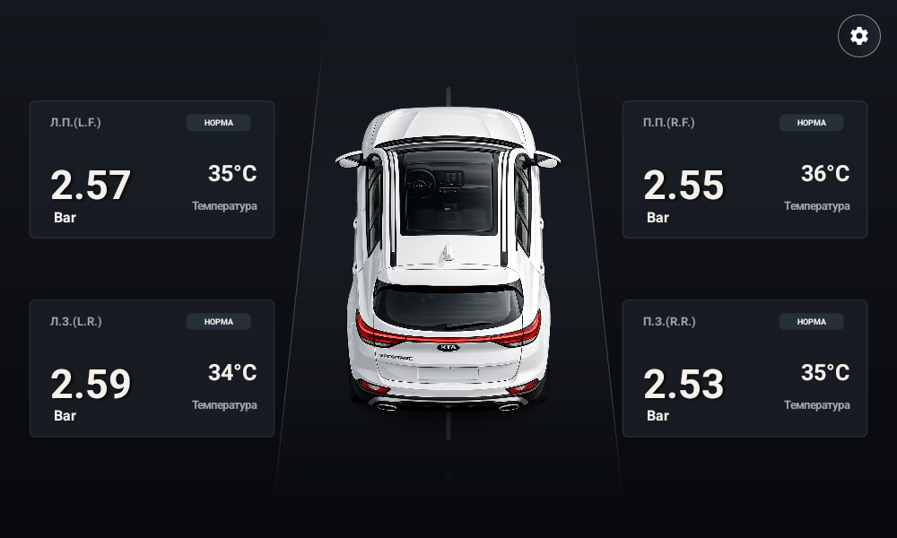 | 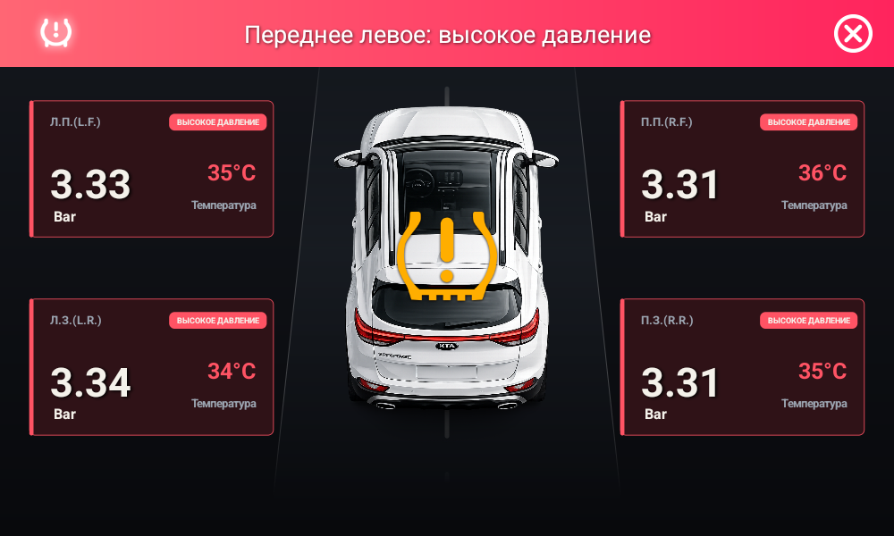 |

| Widget mode | Sunroof |
| --- | --- |
| 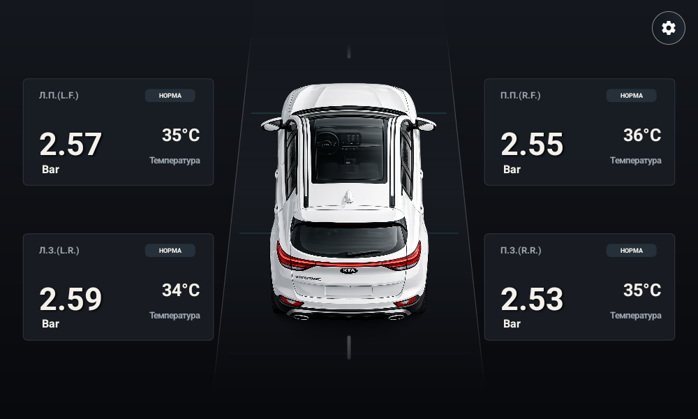 | 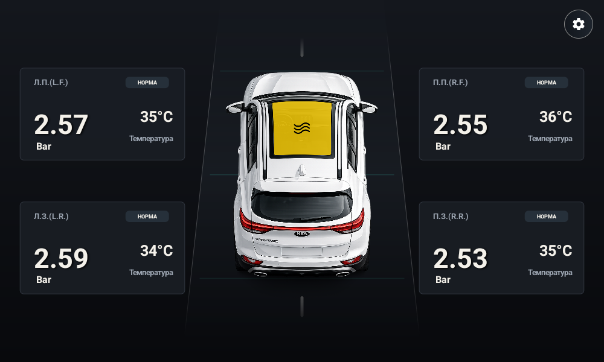 |

| RCTA overlay | RCTA settings |
| --- | --- |
| 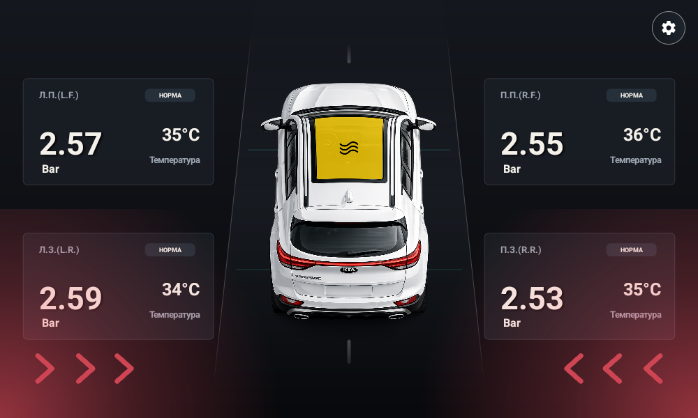 | 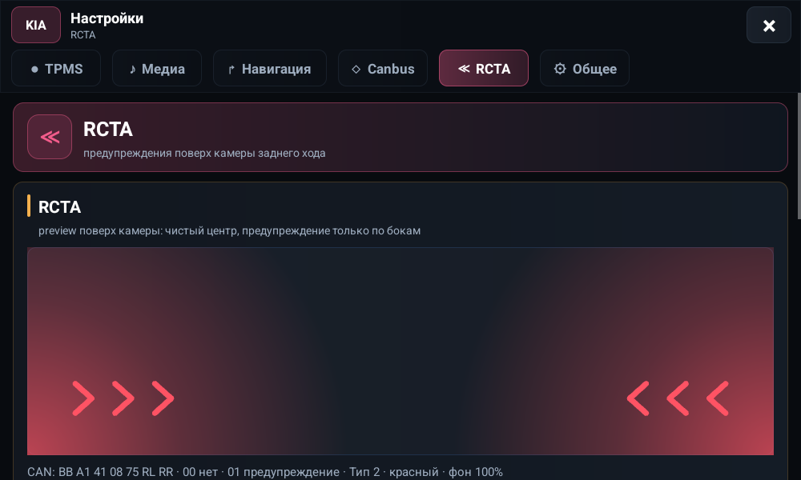 |

| Navigation | Media |
| --- | --- |
| 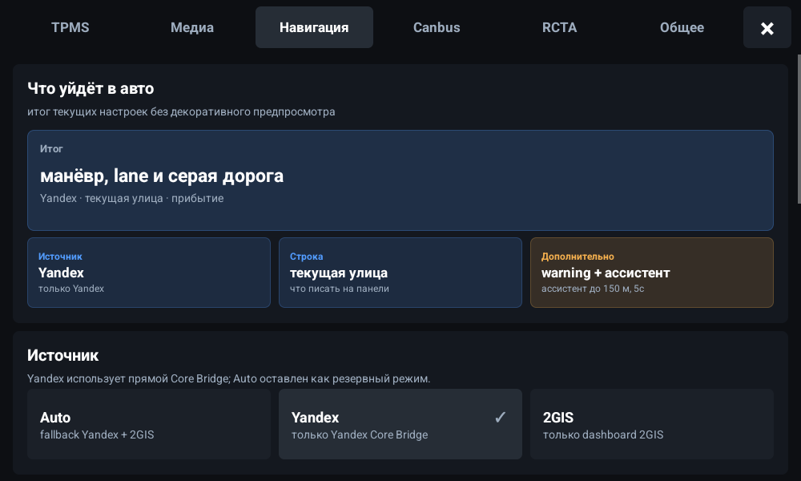 | 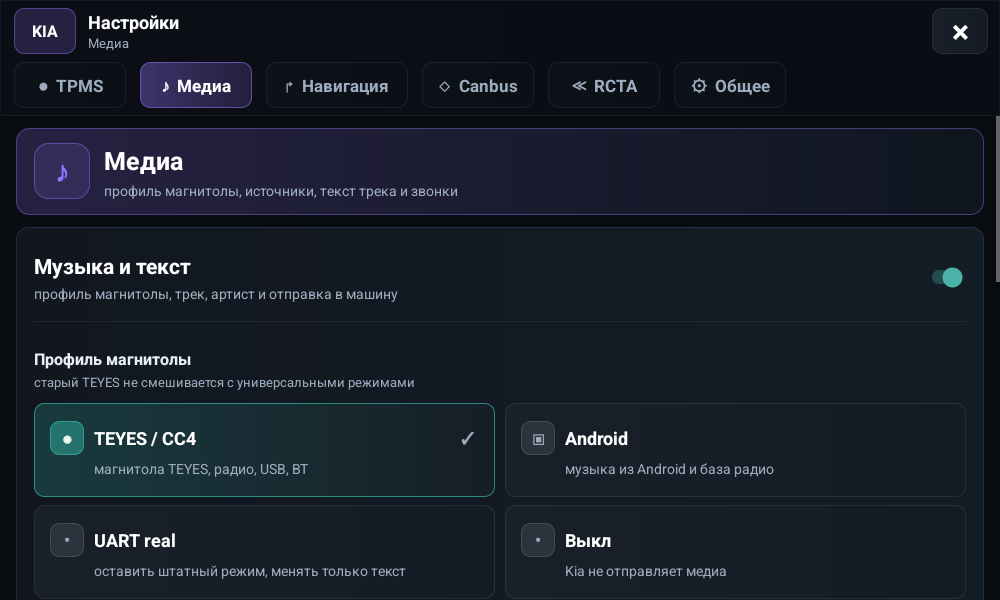 |

| TPMS settings | CANBUS |
| --- | --- |
| 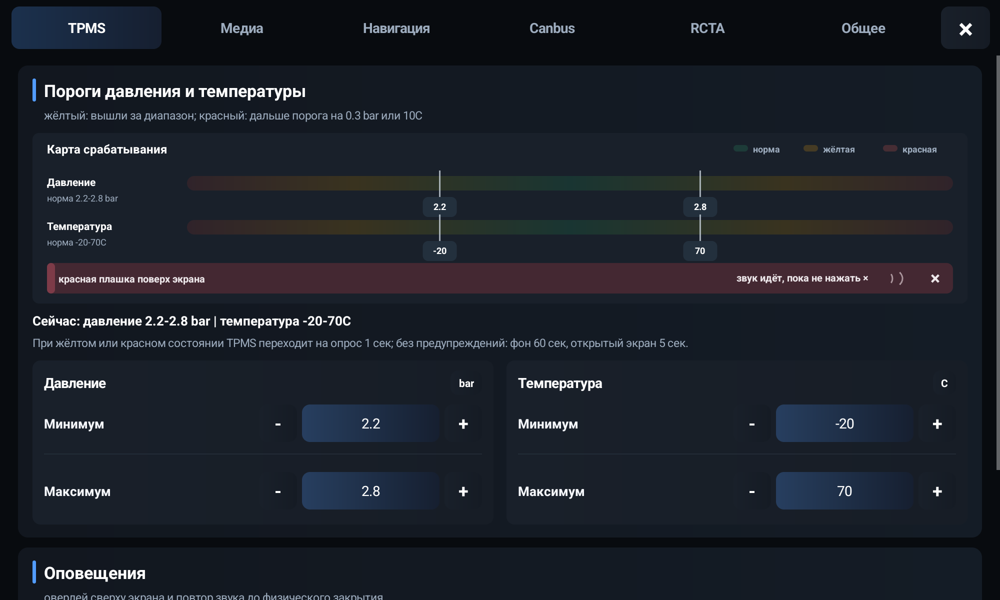 | 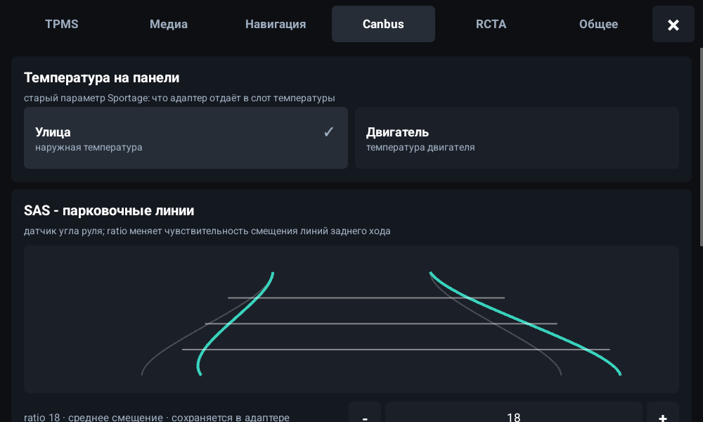 |

| General |
| --- |
| 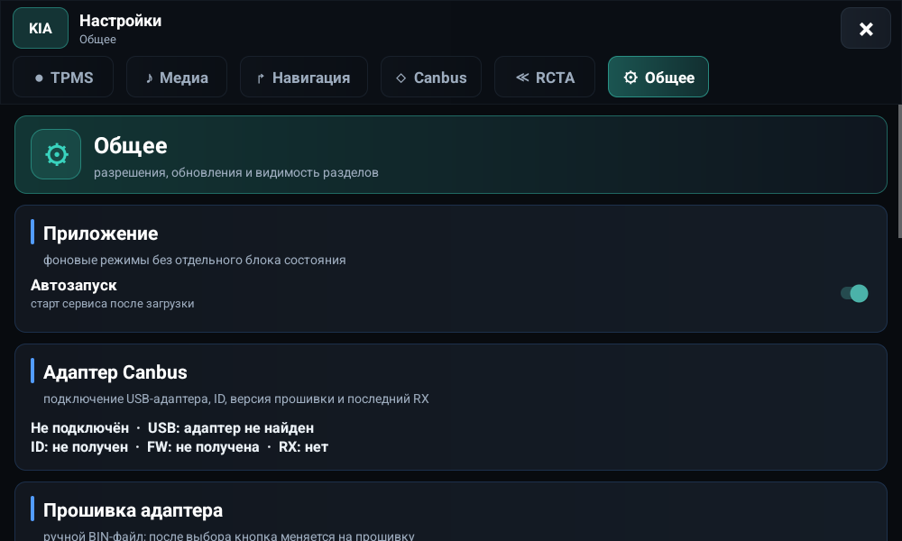 |

## Установка

ADB:

```bash
adb install -r updates/kia_370.apk
curl -L -o /tmp/yandex_navi-7_10-universal-kia-mod-teyes-compat.apk \
  https://github.com/mrglonin/kia/releases/download/v23.10-364/yandex_navi-7_10-universal-kia-mod-teyes-compat.apk
adb install -r /tmp/yandex_navi-7_10-universal-kia-mod-teyes-compat.apk
```

На магнитоле:

1. Установить `kia_370.apk`.
2. Выдать runtime permissions: уведомления, геолокация и Bluetooth — только для используемых функций.
3. Включить специальные права: поверх окон, доступ к уведомлениям и игнор оптимизации батареи.
4. Подключить USB CAN-адаптер, переделанный и прошитый по инструкции автора: [Drive2 76508](https://www.drive2.ru/users/76508/), [переделка адаптера](https://www.drive2.ru/l/717368666034802531/).
5. Установить или обновить Yandex Navigator mod до `yandex_navi-7_10-universal-kia-mod-teyes-compat.apk`. Package/versionCode остаются `ru.yandex.yandexnavi` / `71011062`; KIA распознаёт новую сборку по SHA-256 и размеру.

С уже установленного Kia mod обновление ставится поверх и сохраняет данные. Официальный либо иначе подписанный Yandex Android не разрешит заменить этим APK: сначала сохраните нужные данные, удалите прежнее приложение и затем установите mod.

## Сборка

Требования: Android SDK, JDK 17 из Android Studio, Gradle wrapper из `app/`.

```bash
cd app
JAVA_HOME="/Applications/Android Studio.app/Contents/jbr/Contents/Home" \
ANDROID_HOME="/Users/legion/Library/Android/sdk" \
./gradlew :app:assembleRelease --console=plain
```

Release-сборка подписывается публичным debug-keystore из `signing/kia-debug-release.keystore`, чтобы публичный APK можно было пересобрать с той же подписью. Для своего форка меняйте keystore в `app/app/build.gradle`.

## QA

Проверки настоящего кода на JVM (нужны JDK, Android SDK и JUnit-зависимости после Gradle unit-тестов):

```bash
python3 tools/tpms_regression.py --output /tmp/kia-tpms-check
python3 tools/compass_regression.py --output /tmp/kia-compass-check
```

Для TPMS доступны отдельные сценарии `tools/tpms_regression/scheduler.py`, `alerts.py` и `health.py`; каждый принимает `--source` и `--output`. Используются `JAVA_HOME`/`PATH` и `ANDROID_HOME`/`ANDROID_SDK_ROOT`; журналы и хеши исходников сохраняются в каталоге результата. Эти проверки не устанавливают приложение на устройство и не измеряют физический USB, звук или датчики.

Быстрые сценарии через встроенный `QaReceiver`:

```bash
ADB=/Users/legion/Library/Android/sdk/platform-tools/adb
$ADB -s emulator-5554 install -r updates/kia_370.apk
$ADB -s emulator-5554 shell am start -n kia.app/.entry.MainActivity
$ADB -s emulator-5554 shell am broadcast -n kia.app/.qa.QaReceiver -a kia.app.QA_SCENARIO --es scenario tpms_sample
$ADB -s emulator-5554 shell am broadcast -n kia.app/.qa.QaReceiver -a kia.app.QA_SCENARIO --es scenario tpms_high_pressure_warning
$ADB -s emulator-5554 shell am broadcast -n kia.app/.qa.QaReceiver -a kia.app.QA_SCENARIO --es scenario nav_stale_lane_conflict_sample
$ADB -s emulator-5554 shell am broadcast -n kia.app/.qa.QaReceiver -a kia.app.QA_SCENARIO --es scenario nav_micro_main_counter_sample
$ADB -s emulator-5554 shell am broadcast -n kia.app/.qa.QaReceiver -a kia.app.QA_SCENARIO --es scenario nav_main_preview_sample
$ADB -s emulator-5554 shell am broadcast -n kia.app/.qa.QaReceiver -a kia.app.QA_SCENARIO --es scenario nav_roundabout_exit_continuity_sample --ei exit 3 --ez tbt false
$ADB -s emulator-5554 shell am broadcast -n kia.app/.qa.QaReceiver -a kia.app.QA_SCENARIO --es scenario nav_speed_limit_clear_sample
$ADB -s emulator-5554 shell am broadcast -n kia.app/.qa.QaReceiver -a kia.app.QA_SCENARIO --es scenario nav_speed_limit_idle_sample
$ADB -s emulator-5554 shell am broadcast -n kia.app/.qa.QaReceiver -a kia.app.QA_SCENARIO --es scenario rcta_both
```

Проверка установленной версии:

```bash
adb shell dumpsys package kia.app | grep -E 'versionCode|versionName|lastUpdateTime'
```

Подробный журнал решений и фактических TX в приборку:

```bash
adb pull /sdcard/Android/data/kia.app/files/navigation-logs/
```

## Структура

- `app/` - Android Gradle project для `kia.app`.
- `updates/` - публичные APK и `latest.json`.
- `updates/yandex/` - прежний совместимый ARM7-артефакт; актуальный universal Yandex mod публикуется в assets текущего GitHub Release.
- `signing/` - публичный debug release keystore.
- `tools/` - CAN/UART/navigation/APK utilities.
- `docs/screenshots/` - скриншоты текущего публичного релиза.

## Границы

- APK Yandex Navigator mod лежит как готовый installable artifact; права на Yandex/брендовые компоненты не переоформляются этим репозиторием.
- Рабочий USB CAN-адаптер не является обычным заводским адаптером: нужна переделка и прошивка от [автора Drive2](https://www.drive2.ru/users/76508/), описание здесь: [drive2.ru/l/717368666034802531](https://www.drive2.ru/l/717368666034802531/).
- Публичный debug-keystore нужен для воспроизводимости обновлений, не используйте его как приватный production key.
- `updates/latest.json` и ссылки в этом README указывают на текущий публичный `main`.

## Лицензия

Исходный код KIA-приложения и локальные tools открыты по MIT License. Сторонние APK, фирменные изображения, логотипы и материалы сохраняют права владельцев.
